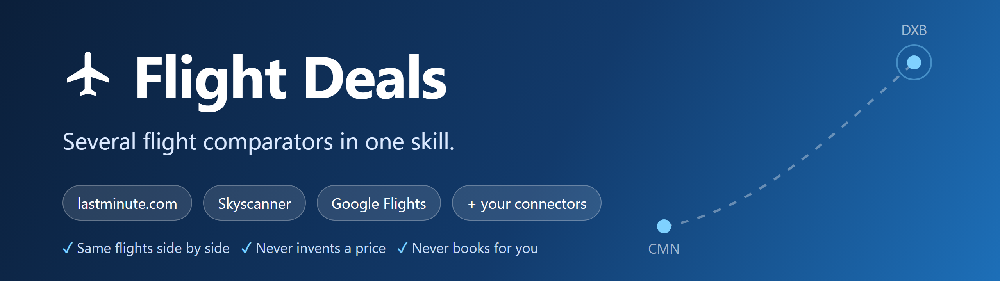
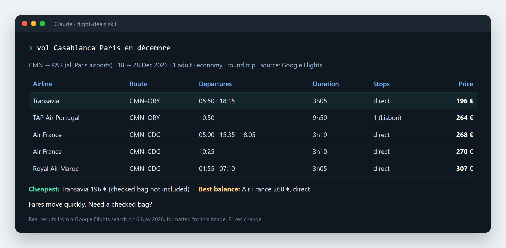

<p align="center"></p>

# Flight Deals

**Écrivez votre trajet. Obtenez les meilleurs vols. Sans configuration.**

Un skill pour Claude (et tout agent qui lit le format `SKILL.md`) qui trouve
les meilleures offres de vols, compare le vrai prix total et **n'invente
jamais un prix**.

🇬🇧 [Read in English](README.md)

```bash
npx skills add abdillahbo54-commits/flight-deals --skill flight-deals
```

## Exemple réel

<p align="center"></p>

<details>
<summary>La même démo en texte (français)</summary>

> **Vous :** vol Casablanca Paris en décembre
>
> **Agent :** Recherche CMN → PAR (tous les aéroports de Paris), du 18 au
> 28 déc. 2026, 1 adulte, économie, aller-retour. Source : Google Flights,
> recherche du 6 nov. 2026.
>
> | Compagnie | Trajet | Départs | Durée | Escales | Prix |
> |---|---|---|---|---|---|
> | Transavia | CMN–ORY | 05:50 · 18:15 | 3 h 05 | direct | 196 € |
> | TAP Air Portugal | CMN–ORY | 10:50 | 9 h 50 | 1 (Lisbonne) | 264 € |
> | Air France | CMN–CDG | 05:00 · 15:35 · 18:05 | 3 h 10 | direct | 268 € |
> | Air France | CMN–CDG | 10:25 | 3 h 10 | direct | 270 € |
> | Royal Air Maroc | CMN–CDG | 01:55 · 07:10 | 3 h 05 | direct | 307 € |
>
> **Le moins cher :** Transavia 196 € (bagage en soute non inclus dans ce prix).
>
> **Meilleur équilibre :** Air France 268 €, direct, trois horaires.
>
> Les prix bougent vite. Besoin d'un bagage en soute ?

</details>

*Recherche réelle faite lors du test ; les prix changent, vos résultats
seront différents.* Les vols au même prix qui ne diffèrent que par l'horaire
sont regroupés sur une ligne.

## Pourquoi ce skill

- **Un seul message suffit.** Départ, arrivée et mois → résultats. Au plus
  une question, après avoir montré les vols.
- **N'invente jamais un prix.** Chaque prix vient d'un vrai outil, avec sa
  source et l'heure de recherche. Aucune source disponible ? Il le dit.
- **Ne réserve jamais à votre place.** Vous recevez le lien et vous décidez.
- **Vrai prix total.** Bagages, frais, escales longues et correspondances
  risquées sont signalés.
- **Clair.** Top 5 d'abord, liste complète sur demande.
- **Multilingue.** Répond dans votre langue (français, anglais, arabe…).
- **Partout dans le monde.** Conseils par région (Europe, Maghreb, Amérique
  du Nord, Golfe, Afrique, Asie, Amérique latine, Océanie) : périodes de
  pointe, bagages, aéroports alternatifs, correspondances via les hubs.

## Installation

Avec la CLI `skills` :

```bash
npx skills add abdillahbo54-commits/flight-deals --skill flight-deals
```

À la main (Claude Code) :

```bash
git clone https://github.com/abdillahbo54-commits/flight-deals.git
mkdir -p ~/.claude/skills
cp -r flight-deals/skills/flight-deals ~/.claude/skills/
```

Sur claude.ai : zippez le dossier `skills/flight-deals` et importez-le dans
**Paramètres → Capacités → Skills**.

## Exemples de demandes

- « vol Casablanca Paris en décembre »
- « Billet d'avion pas cher Bruxelles – Nador cet été, 2 adultes, bagage 23 kg »
- « Quelles sont les dates les moins chères pour Lisbonne cet été ? »
- « Préviens-moi si Paris → Bangkok passe sous 500 € »
- « Vol + hôtel 5 nuits à Istanbul en juin »

## Voyageurs, aller simple, dates…

Écrivez-le simplement dans votre phrase, dans n'importe quel ordre. Ce que
vous ne précisez pas prend la valeur par défaut.

| Vous voulez | Écrivez par exemple | Par défaut |
|---|---|---|
| Voyageurs et âges | « 2 adultes », « à deux », « 2 adultes + enfants de 5 et 9 ans », « un bébé de 10 mois », « un ado de 15 ans » | 1 adulte |
| Type de trajet | « aller simple » / « aller-retour » / « retour depuis Marrakech » | aller-retour |
| Escales | « direct uniquement », « 1 escale max », « escale de moins de 3 h », « pas d'escale de nuit » | toutes |
| Stopover | « stopover de 2 jours à Istanbul » / « pas de stopover » | aucun |
| Dates | « en décembre » (souple ±3 jours) ou « du 18 au 28 décembre » (exactes) | souples |
| Bagage | « avec une valise de 23 kg », « bagage en soute » | non inclus |
| Classe | « business », « premium » | économie |

Exemples :
- *« vol Paris Marrakech aller simple le 12 avril, 2 adultes et 1 enfant de
  6 ans, avec bagage »*
- *« Paris Bangkok en mars, 1 escale max, pas d'escale de nuit »*
- *« Casablanca Montréal en juillet avec un stopover de 2 jours à Lisbonne »*

Si un filtre ne laisse aucun vol, le skill le dit et propose les options les
plus proches (ex. « pas de vol direct ; le meilleur avec 1 escale »).

Un oubli ? Après les résultats, répondez simplement « à deux, aller simple » :
la recherche est relancée avec les nouveaux réglages. Les prix affichés sont
toujours le total pour tous les voyageurs.

## Fonctionnement

1. **Mode rapide.** Par défaut : 1 adulte, économie, aller-retour, ±3 jours,
   codes ville (PAR, LON, NYC…) pour couvrir tous les aéroports.
2. **Recherche.** Tous les connecteurs de vols disponibles, en parallèle
   (lastminute.com, eDreams, Expedia, SlickTrip…). Avec un outil navigateur
   (comme Claude in Chrome), il compare **toujours** avec **Skyscanner** et
   **Google Flights**, et affiche un tableau des prix côte à côte pour les
   mêmes vols.
3. **Robuste.** Une seule relance par source, puis l'échec est signalé en une
   ligne et la recherche continue. Jamais de contournement de connexion, de
   captcha ou de protection.
4. **Regroupement et classement.** Doublons fusionnés ; le moins cher, le plus
   rapide et le meilleur équilibre sont mis en avant.
5. **Présentation.** Tableau compact qui respecte les règles d'affichage de
   chaque outil (prix exact, lien de réservation non modifié).

Les liens de réservation viennent des sites partenaires et peuvent contenir
des paramètres de suivi ; le skill le signale et ne les modifie pas.

## En option, sur demande

Alertes de prix · total vol + hôtel · sauvegarde dans Sheets / Notion ·
réservation provisoire dans l'agenda.

## Sécurité

- Ne réserve et ne paie jamais sans votre accord explicite
- Ne saisit jamais de données de paiement, de passeport ou de connexion
- N'invente jamais de prix, d'horaires ou de disponibilités
- Ne contourne jamais connexions, captchas ou protections
- Ne modifie jamais le lien de réservation fourni par un outil

## Contribuer

Issues et pull requests bienvenues : nouvelles sources, codes ville,
conseils régionaux, traductions.

## Licence

MIT
