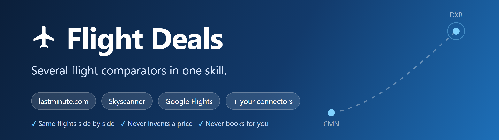
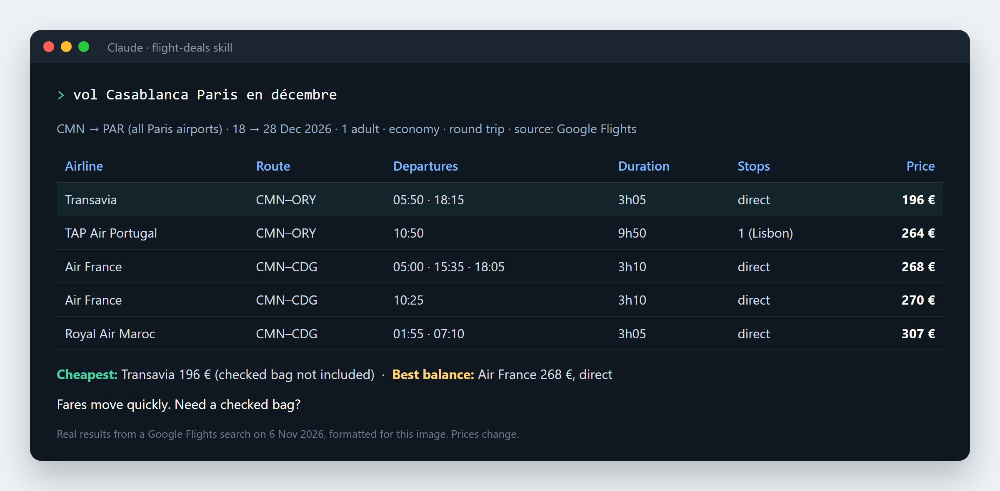

<p align="center"></p>

# Flight Deals

An agent skill for Claude (and any agent that reads `SKILL.md`) that finds
the best flight offers, compares the real total price, and **never invents a
price**.

🇫🇷 [Lire en français](README.fr.md)

```bash
npx skills add abdillahbo54-commits/flight-deals --skill flight-deals
```

## See it in action

<p align="center"></p>

<details>
<summary>Same demo as text</summary>

> **You:** vol Casablanca Paris en décembre
>
> **Agent:** Searched CMN → PAR (all Paris airports), 18 → 28 Dec 2026,
> 1 adult, economy, round trip. Source: Google Flights, searched 6 Nov 2026.
>
> | Airline | Route | Departures | Duration | Stops | Price |
> |---|---|---|---|---|---|
> | Transavia | CMN–ORY | 05:50 · 18:15 | 3h05 | direct | 196 € |
> | TAP Air Portugal | CMN–ORY | 10:50 | 9h50 | 1 (Lisbon) | 264 € |
> | Air France | CMN–CDG | 05:00 · 15:35 · 18:05 | 3h10 | direct | 268 € |
> | Air France | CMN–CDG | 10:25 | 3h10 | direct | 270 € |
> | Royal Air Maroc | CMN–CDG | 01:55 · 07:10 | 3h05 | direct | 307 € |
>
> **Cheapest:** Transavia 196 € (checked bag not included in the price shown).
>
> **Best balance:** Air France 268 €, direct, three departure times.
>
> Fares move quickly. Need a checked bag?

</details>

*Real search from the author's test run; prices change, your results will
differ.* Same-price flights that differ only by time are grouped on one line.

## Why this skill

- **One message is enough.** Origin, destination and month → results. It asks
  at most one question, after showing the flights.
- **Never invents a price.** Every price comes from a real tool, with its
  source and search time. No source available? It says so.
- **Never books for you.** You get the booking link and decide.
- **Real total price.** Bags, fees, long layovers and self-transfer risks
  are flagged.
- **Compact and readable.** Top 5 first, full list on request.
- **Multilingual.** Answers in your language (French, English, Arabic…).
- **Works worldwide.** Regional tips for Europe, Maghreb, North America,
  Gulf, Africa, Asia, Latin America and Oceania: peak periods, baggage,
  alternate airports, hub connections.

## Install

With the `skills` CLI:

```bash
npx skills add abdillahbo54-commits/flight-deals --skill flight-deals
```

Manually (Claude Code):

```bash
git clone https://github.com/abdillahbo54-commits/flight-deals.git
mkdir -p ~/.claude/skills
cp -r flight-deals/skills/flight-deals ~/.claude/skills/
```

On claude.ai: zip the `skills/flight-deals` folder and upload it in
**Settings → Capabilities → Skills**.

## Try it

- "vol Casablanca Paris en décembre"
- "Cheap flights London to Dubai in March"
- "Billet d'avion pas cher Bruxelles – Nador cet été, 2 adultes, bagage 23 kg"
- "Cheapest dates to fly to Lisbon this summer?"
- "Alert me if Paris → Bangkok drops under 500 €"
- "Flight + hotel for 5 nights in Istanbul in June"

## Travellers, one way, dates…

Just write it in your sentence, in any order and any language. Anything you
don't say uses the default.

| You want | Write for example | Default |
|---|---|---|
| Travellers and ages | "2 adults", "à deux", "2 adults + children of 5 and 9", "a baby of 10 months", "a teen of 15" | 1 adult |
| Trip type | "one way", "aller simple" / "round trip" / "back from Marrakech" (open-jaw) | round trip |
| Stops | "direct only", "max 1 stop", "layover under 3 h", "no overnight layover" | any |
| Stopover | "2-day stopover in Istanbul" / "no stopover" | none |
| Dates | "in December" (flexible ±3 days) or "18 to 28 December" (exact) | flexible |
| Baggage | "with a 23 kg bag", "valise en soute" | not included |
| Cabin | "business", "premium economy" | economy |

Examples:
- *"vol Paris Marrakech aller simple le 12 avril, 2 adultes et 1 enfant de 6
  ans, avec bagage"*
- *"Paris to Bangkok in March, max 1 stop, no overnight layover"*
- *"Casablanca Montréal en juillet avec un stopover de 2 jours à Lisbonne"*

If a filter leaves no flight, the skill says so and shows the closest
options (e.g. "no direct flight; best with 1 stop").

Forgot something? After the results, just reply "à deux, aller simple": the
search runs again with the new settings. Prices shown are always the total
for all travellers.

## How it works

1. **Quick mode.** Defaults: 1 adult, economy, round trip, ±3 days, city
   codes (PAR, LON, NYC…) to cover every airport.
2. **Search.** Every flight connector available to the agent, in parallel
   (lastminute.com, eDreams, Expedia, SlickTrip…). With a browser tool (e.g.
   Claude in Chrome) it **always** compares with **Skyscanner** and **Google
   Flights** too, and shows a side-by-side price table for the same flights.
3. **Robust.** One retry per source, then it reports the failure in one line
   and continues. It never bypasses logins, captchas or site protections.
4. **Group and rank.** Duplicate fares merged, cheapest / fastest / best
   balance picked.
5. **Present.** Compact table, each tool's display rules respected (exact
   price, unmodified booking link).

Booking links come from partner sites and may contain tracking parameters;
the skill says so and does not alter them.

## Supported services

Tools are detected automatically. See
[`references/sources.md`](skills/flight-deals/references/sources.md).

| Type | Examples |
|---|---|
| Flight connectors | lastminute.com, eDreams, SlickTrip, Expedia |
| Hotel / package connectors | Booking.com, Trivago, lastminute.com, eDreams |
| Browser (optional) | Google Flights, Skyscanner, Trip.com, Kayak, airline sites |
| Storage / calendar | Google Drive & Sheets, Notion, Calendar |
| Scheduling | Scheduled tasks for price alerts |

## Extras on request

Price alerts · flight + hotel total · save the shortlist to Sheets / Notion ·
calendar hold.

## Safety

- Never books or pays without explicit confirmation
- Never types payment, passport or login details
- Never invents prices, schedules or availability
- Never bypasses logins, captchas or site protections
- Never removes or alters a tool's booking link

## Repository layout

```
flight-deals/
├── README.md / README.fr.md / CHANGELOG.md / LICENSE
├── assets/                     # banner and demo images
└── skills/flight-deals/
    ├── SKILL.md
    └── references/
        ├── sources.md              # sources + Google Flights procedure
        ├── iata-codes.md           # city & airport codes
        ├── comparison-checklist.md
        ├── price-alerts.md
        └── regional-tips.md       # peaks, bags, hubs by region
```

## Contributing

Issues and pull requests welcome: new sources (a row in `sources.md`), new
city codes (`iata-codes.md`), regional tips, translations.

## License

MIT
